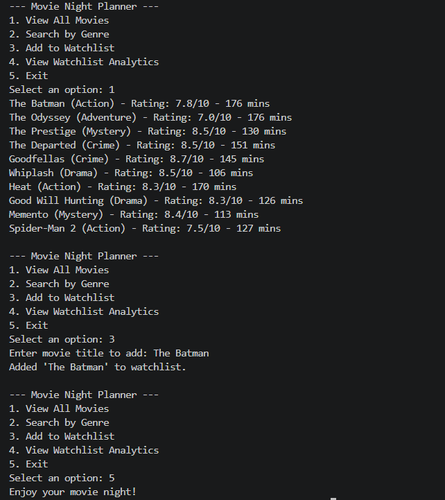
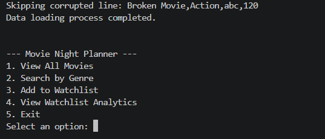

# Week 2: Advanced Python & Data Structures
**IEEE LGU AI/ML Cohort One**  
**AI/ML Leads:** Abdullah Faisal & Alina Irshad  

## 1. Project Overview
The Movie Night Planner is a console application that allows users to browse a dynamically loaded database of movies, filter them by genre, and curate a personal watchlist. It solves the problem of organizing media data safely by validating inputs and automatically calculating watchlist analytics like total watch time and average ratings.

## 2. Concepts Implemented
- **Object-Oriented Programming (Classes, Objects, Encapsulation, Inheritance):** Utilizes a custom Movie class to cleanly encapsulate attributes like title, genre, rating, and duration.
- **File Handling (Reading external data dynamically):** Dynamically opens and reads data from the external data/movies.csv file using a with block.
- **Error & Exception Handling (try/except/finally with corrupt data handling):** Implements robust try/except/finally blocks to catch ValueError exceptions if a row is formatted incorrectly, ensuring the program skips bad data rather than crashing.
- **Data Structures (Lists, Sets, Tuples, Dictionaries):** Employs Python lists to store the main database and a set to strictly prevent duplicate movies from being added to the watchlist.
- **List / Dictionary Comprehension:** Uses list comprehensions for efficient, one-line filtering of the movie database by genre.

## 3. How to Run the Program
python main.py

## 4. Dataset Information
The dataset is an external file named movies.csv containing 10 valid movie records (including titles like The Batman, The Prestige, and Whiplash). To demonstrate the corrupt data handling, you can optionally add a broken row to the bottom of your CSV (e.g., Broken Movie,Action,abc,120); the parser will catch the text abc in the float column and gracefully skip it.

## 5. Execution Screenshots & Proof

